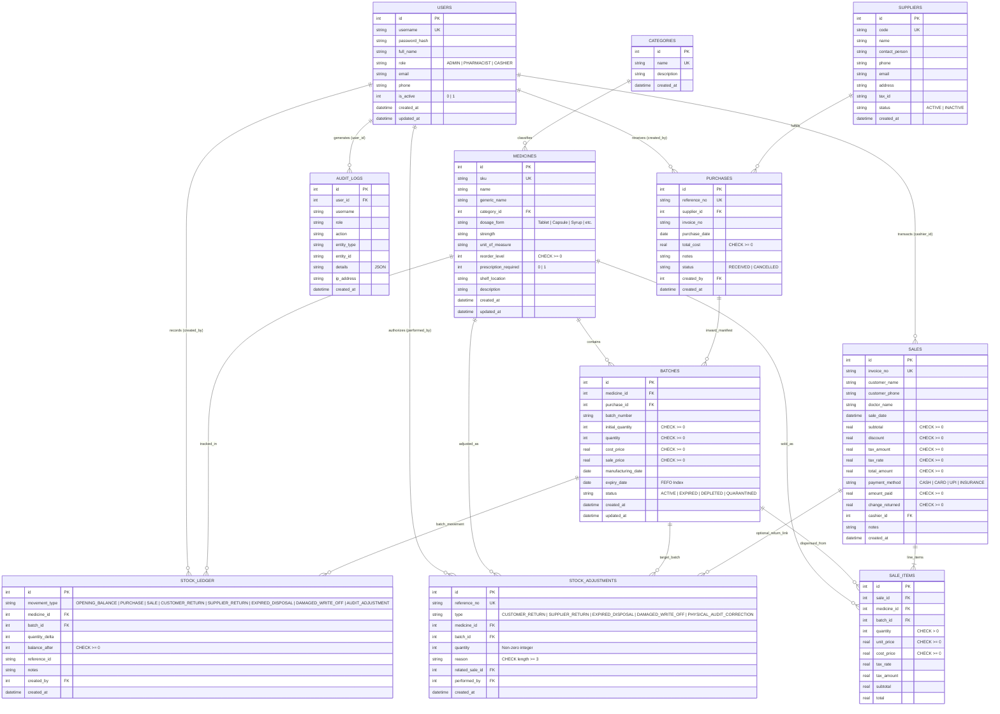

# Entity-Relationship (ER) Diagram & Schema Data Dictionary

This document details the relational data architecture of the **MediCare Pharmacy Management System**, implemented in SQLite with ACID compliance, strict check constraints, foreign keys, and immutable stock ledger auditing.

---

## 1. Mermaid Entity-Relationship Diagram

---

## 2. Relational Integrity and Data Constraints

1. **Atomic Batch Tracking & Non-Negative Stock Guarantee:**
   - Every stock deduction references a specific `batch_id`. Stock is never treated as an undifferentiated lump sum.
   - Database constraint `batches.quantity CHECK(quantity >= 0)` guarantees at the engine level that stock cannot become negative.
   - Pre-validation in `salesService` and `adjustmentService` enforces that `available >= requested` before deducting.

2. **Mandatory Operational Reasons:**
   - `stock_adjustments.reason CHECK(length(trim(reason)) >= 3)` enforces at the database level that no stock adjustment or write-off can be saved without an explicit operational rationale.

3. **Perpetual Inventory Reconciliation:**
   - The immutable `stock_ledger` table captures the exact delta and post-transaction balance for every single business action (`PURCHASE`, `SALE`, `CUSTOMER_RETURN`, `SUPPLIER_RETURN`, `EXPIRED_DISPOSAL`, `DAMAGED_WRITE_OFF`, `AUDIT_ADJUSTMENT`).
   - The perpetual formula `Opening + Purchases - Sales + CustomerReturns - SupplierReturns - Disposals/Damaged +/- AuditAdjustments = Closing Stock` guarantees 100% mathematical auditability.

